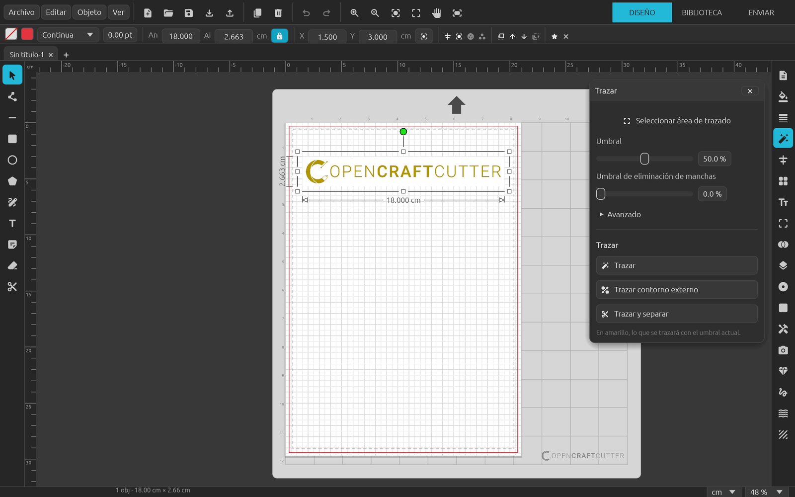

<p align="center">
  <picture>
    <source media="(prefers-color-scheme: dark)" srcset="docs/logo-dark.png">
    
  </picture>
</p>

# OpenCraftCutter

Software libre de diseño y corte para cortadoras de manualidades, compatible con **Silhouette Cameo®** (objetivo inicial: **Cameo 5**). 100 % Rust: `egui` para la interfaz y `wgpu` para dibujar. Textos en español.

> **Estado:** en desarrollo. Diseño completo; envío a la máquina por Bluetooth (GPGL).



## Funciones

**Documento y archivos**
- Pestañas de documentos; formato propio `.opencraftcutter` (JSON).
- **Abrir** documentos, SVG e imágenes (PNG, JPG, GIF, BMP, WebP, TIFF): SVG e imágenes se abren en un documento nuevo, como en Silhouette Studio.
- **Abrir documentos de Silhouette Studio (`.studio3`)**: formas, trazados compuestos, curvas, rotación, colores de línea y relleno, e imágenes incrustadas (también los rellenos de imagen, recortados por su contorno). Los textos se importan como texto editable (contenido, fuente y tamaño, en el sitio de sus letras).
- Arrastrar desde Finder: SVG e imágenes se añaden al tapete donde se sueltan; los documentos se abren en pestaña nueva y, en Biblioteca, se copian a la carpeta.
- Importar SVG e imágenes al documento abierto; exportar SVG (con marcas de registro).

**Dibujo y edición**
- Rectángulo, elipse, línea, polígono, mano alzada y texto (fuentes del sistema).
- **Editar puntos** con nodos Bézier: mover nodos y manejadores, añadir un nodo con un clic en la línea, selección múltiple (Mayús+clic o recuadro), borrar punto, romper trazado, vértice / suavizar, convertir tramo en recta o curva, simplificar y recuento de nodos. Doble clic en una forma entra en este modo.
- Cuchilla y borrador; grupos; trazados compuestos.
- Marco de selección con cotas, barra de selección con tamaño, posición, punto de referencia y acciones rápidas.

**Paneles**
- **Configuración de página:** máquina, alimentación, tapete, medios, orientación, color y transparencia; retícula (cuadrada o isométrica), ajuste a retícula y ajuste inteligente; bordes de impresión y de corte.
- **Relleno:** color (espectro, HEX/RGB/HSL, paletas guardadas) y degradado.
- **Estilo de trazo:** seis estilos de línea, grosor, vértices, remates y posición.
- **Trazar:** motor de trazado propio en blanco y negro (bordes subpíxel, esquinas vivas, curvas Bézier), área de trazado, umbral, filtros, escala, calidad y vista previa; trazar, contorno externo y trazar y separar.
- **Transformar:** alinear, escalar, rotar y mover.
- **Replicar:** duplicar, filas y columnas, llenar página (máximo de copias), reflejar, rotar copias, replicar a medida y objeto en ruta.
- **Estilo de texto:** fuentes con vista previa, negrita, cursiva, subrayado, alineación (incl. justificado), texto vertical, espaciado de líneas y caracteres, interletraje.
- **Imprimir y cortar:** marcas de registro (por defecto o invertidas, inserción por lado) y sangrado de impresión.
- **Modificar:** fusionar, sustraer, sustraer todo, interseccionar, dividir, recortar; crear, soltar y separar trazados compuestos.
- **Desplazamiento:** exterior e interior, vértice, límite de esquina y vista previa; en imágenes PNG sigue la silueta (canal alfa), huecos incluidos.
- **Herramientas especiales:** relieve, puntuar y grabar en relieve, grabador, lápiz térmico, punzón de cuero, tallador de cuero y Enviar a S3D.
- **PixScan:** importar la foto del tapete, calibración de cámara con la tarjeta de puntos y rectificación de perspectiva.
- Capas, pedrería y boceto.

**Biblioteca**
- Carpeta local con documentos, SVG e imágenes con miniatura; Recientes, Todos los diseños y árbol de carpetas.
- Búsqueda por nombre en subcarpetas, orden por nombre o fecha, cuadrícula o lista.
- Nueva carpeta, renombrar, mover, mostrar en Finder y enviar a la Papelera; abrir en pestaña nueva o añadir al documento actual.

**Menús**
- **Objeto:** espejo, organizar, alinear, rotar, replicar, modificar, agrupar, trazados compuestos y simplificar.
- **Ver:** zoom (25–400 %), rotar página, retícula, ajuste inteligente, bordes, marcas de registro y cambio entre Diseño, Biblioteca y Enviar.

## Estructura

```
crates/oc-core    Modelo del documento (mm), nodos Bézier, geometría de edición, operaciones
                  (booleanas, desplazamiento, replicar, organizar, marcas de registro,
                  herramientas especiales), unidades y máquinas. Sin UI.
crates/oc-svg     Importar SVG (usvg: unidades, transformaciones, texto a trazados) y exportar.
crates/oc-studio3 Lectura y escritura de documentos .studio3.
crates/oc-cutter  Envío a la cortadora: comandos GPGL y conexión Bluetooth.
crates/oc-trace   Trazado de imágenes (motor propio y vtracer para color), siluetas por canal
                  alfa y PixScan (calibración y rectificación).
apps/opencraftcutter
                  Aplicación de escritorio (eframe + egui + wgpu).
```

Las longitudes del documento se guardan en **milímetros**; la unidad elegida solo se aplica en la interfaz.

## Desarrollo

```bash
cargo run -p opencraftcutter                  # app (perfil dev con dependencias optimizadas)
cargo test --workspace                        # pruebas
cargo clippy --workspace --all-targets -- -D warnings
cargo fmt
cargo build --release                         # binario optimizado
./scripts/build-dmg.sh                        # dist/OpenCraftCutter-<versión>.dmg (Apple Silicon)
UNIVERSAL=1 ./scripts/build-dmg.sh            # también Intel (tarda el doble)
```

Sin un certificado «Developer ID» el DMG va firmado *ad hoc*: la primera vez hay que abrir la app con clic derecho › Abrir. Con `SIGN_ID` y `NOTARY_PROFILE` se firma y se notariza para abrirse sin avisos en cualquier Mac.

Demos de depuración (solo en builds de desarrollo), con la variable `OPENCRAFTCUTTER_DEBUG_DEMO`:
`fill`, `line`, `trace`, `transform`, `replicate`, `text`, `printcut`, `special`.
Otras: `OPENCRAFTCUTTER_DEBUG_IMAGE`, `OPENCRAFTCUTTER_DEBUG_OPEN_PATH`, `OPENCRAFTCUTTER_DEBUG_PIXSCAN`, `OPENCRAFTCUTTER_DEBUG_LIBRARY` (carpeta).

## Atajos

**Herramientas:** V seleccionar · A editar puntos · L línea · R rectángulo · E elipse · G polígono · P mano alzada · T texto · H desplazar · Z zoom

**Edición:** ⌘Z / ⇧⌘Z deshacer y rehacer · ⌘A seleccionar todo · ⇧⌘A deseleccionar · ⌘D duplicar · Supr borrar · Flechas mover (⇧ ×10) · Espacio desplazar

**Objeto:** ⌘G agrupar · ⇧⌘G desagrupar · ⌘E crear trazado compuesto · ⇧⌘E soltar trazado compuesto · ⌘J simplificar · ⇧⌘W fusionar · ⇧⌘F llenar página · ⇧⌘] / ⇧⌘[ traer al frente / enviar al fondo · ⌘] / ⌘[ adelante / atrás

**Ver:** ⌘1 ajustar a ventana · ⌘2 zoom a la selección · ⌘+ / ⌘- zoom · ⇧⌘P bordes de impresión · ⇧⌘L bordes de corte · ⌥⌘D diseño · ⌥⌘L biblioteca

**Archivo:** ⌘N nuevo · ⌘O abrir · ⌘S guardar · ⇧⌘S guardar como · ⇧⌘I importar SVG · ⇧⌘M importar imagen · ⌥⌘E exportar SVG · ⌘, preferencias

## Licencia

[GPL-3.0 o posterior](LICENSE). Puedes usar, estudiar, modificar y compartir el programa; si distribuyes una versión modificada, debe publicarse también con esta licencia y con su código fuente.

Se ofrece **sin ninguna garantía**: úsalo bajo tu responsabilidad, también con tu máquina y tus materiales.

## Aviso

OpenCraftCutter es un proyecto independiente y **no está afiliado, patrocinado ni respaldado por Silhouette America, Inc.** Silhouette, Silhouette Cameo, Silhouette Studio, Portrait, Curio y PixScan son marcas de sus respectivos propietarios y se mencionan solo para indicar compatibilidad.
